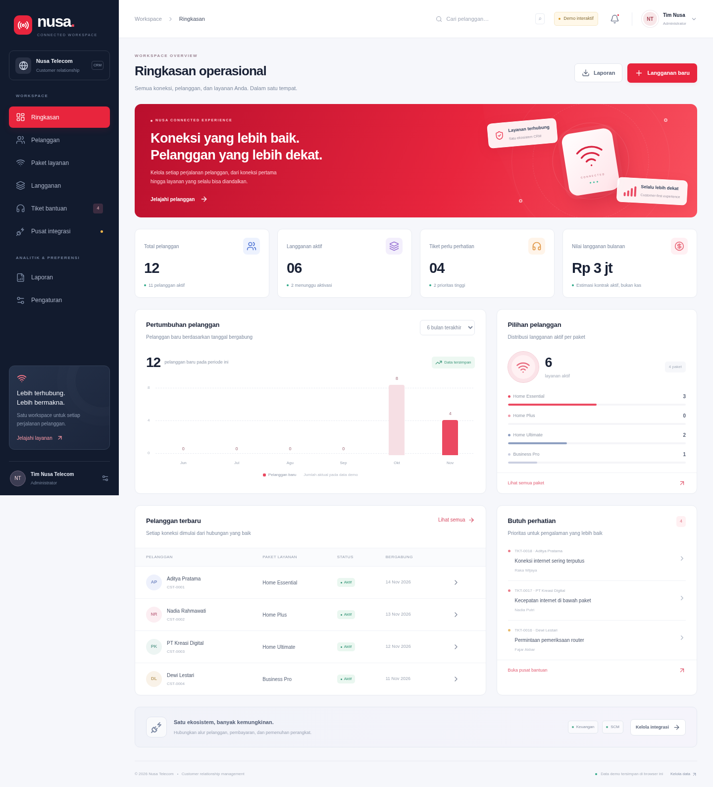

# Nusa CRM · Connected Workspace

Demo CRM telekomunikasi dengan tampilan portal operator: sidebar navy, aksen merah, katalog paket fiber, dan antarmuka responsif untuk desktop maupun mobile. Dikembangkan sebagai final project Integrasi Aplikasi Korporasi.

**Demo publik:** https://doees.github.io/crm-telko/



## Yang bisa dicoba

| Menu | Fitur yang berfungsi |
|---|---|
| Ringkasan | Metrik dari data tersimpan, grafik periode 3/6 bulan, distribusi paket, pelanggan terbaru, tiket prioritas |
| Pelanggan | Tambah, edit, aktif/nonaktif, profil dengan langganan dan tiket, pencarian, filter, pagination, CSV |
| Paket layanan | Katalog rumah/bisnis, tambah/edit paket, aktif/nonaktif, pilihan paket pada langganan baru |
| Langganan | Pendaftaran, harga kontrak tersimpan, invoice/perangkat otomatis, kesiapan aktivasi, suspend/resume/cancel |
| Tiket bantuan | Pembuatan/edit, prioritas, penugasan teknisi, komentar, transisi penanganan sampai tutup |
| Pusat integrasi | Invoice, callback pembayaran, permintaan perangkat, pemenuhan, simulasi offline, log event dan retry |
| Laporan | Filter periode pendaftaran, nilai kontrak, pembayaran simulasi, ringkasan paket, CSV, jejak aktivitas |
| Pengaturan | Simulasi empat peran, backup JSON, restore tervalidasi, reset dengan konfirmasi |

Notifikasi, pencarian pelanggan di header, navigasi mobile, dan detail data juga berfungsi. Seluruh identitas awal fiktif.

## Batas demo publik

GitHub Pages hanya melayani file statis. **Demo ini menyimpan data pada localStorage browser**, bukan PostgreSQL. Data tidak dibagikan antarperangkat atau antaranggota kelompok. Simulasi peran bukan login, autentikasi, atau kontrol keamanan server. Invoice/pembayaran/perangkat adalah simulasi; tidak ada transaksi uang atau panggilan API eksternal.

Prisma/PostgreSQL dari fondasi tetap disediakan sebagai persiapan backend; schema database awal hanya mencakup Customer. Endpoint API server, autentikasi aman, seluruh model database, dan integrasi nyata belum diimplementasikan pada demo ini. Itu memerlukan hosting server, PostgreSQL serta kontrak/kredensial modul Keuangan/SCM. Jangan memakai data pelanggan nyata.

## Menjalankan lokal

Prasyarat: Node.js 22 LTS atau 24, npm, Git.

```bash
git clone https://github.com/doees/crm-telko.git
cd crm-telko
npm ci
npm run dev
```

Buka http://localhost:3000. Semua menu demo bekerja tanpa `.env` atau koneksi database.

Mode production server lokal:

```bash
npm run build
npm start
```

## Coba satu alur penuh

1. Buka **Pelanggan → Tambah pelanggan** dan isi identitas fiktif.
2. Buka **Langganan → Langganan baru**, pilih pelanggan dan paket. Invoice serta permintaan perangkat masuk antrean.
3. Buka **Pusat integrasi → Invoice & pembayaran**, kirim invoice lalu pilih **Simulasikan lunas**.
4. Pada tab **Pemenuhan perangkat**, kirim permintaan lalu pilih **Simulasikan terpenuhi**. Langganan aktif otomatis setelah kedua syarat selesai.
5. Buka **Tiket bantuan**, buat tiket dan tugaskan teknisi. Mulai penanganan, tambahkan catatan, selesaikan dan tutup tiket.
6. Lihat perubahan pada **Ringkasan** dan **Laporan**, lalu unduh CSV.
7. Coba simulator offline dan retry pada integrasi. Callback berulang tidak menggandakan transaksi.
8. Di **Pengaturan**, uji peran manajer/teknisi, backup dan restore. Untuk reset, kembali ke peran Administrator.

Harga katalog yang diubah tidak mengubah harga kontrak langganan lama. Pembatalan langganan tidak otomatis membuat refund atau mengembalikan perangkat; demo menunjukkan kebutuhan rekonsiliasi terpisah.

## Pemeriksaan

```bash
npm run lint
npm run typecheck
npm test
npm run test:e2e
```

`test` menjalankan aturan bisnis dengan Node test runner melalui tsx. `test:e2e` membangun production server lalu menjalankan Chromium/Playwright pada port 3100. Hentikan server lain pada port tersebut. Jika Chromium belum tersedia:

```bash
npx playwright install chromium
```

Konfigurasi memakai `/usr/bin/chromium` bila tersedia, atau browser Playwright yang terpasang. Override dengan `PLAYWRIGHT_CHROMIUM_PATH` bila perlu. Di GitHub Actions, browser dan dependensi Linux dipasang melalui `playwright install --with-deps chromium`. Trace/screenshot kegagalan disimpan di `test-results/` dan diabaikan Git.

Untuk memeriksa deployment publik:

```bash
python3 scripts/verify_public_site.py
```

Pengujian browser publik dapat dijalankan dengan `E2E_BASE_URL=https://doees.github.io/crm-telko/ npm run test:e2e` (macOS/Linux/Git Bash). Pengujian hanya mengubah localStorage pada konteks browser pengujian, bukan data pengguna lain.

## Struktur kode

```text
src/app/                         Next.js App Router dan layout
src/components/layout/           sidebar, header, pencarian, notifikasi
src/components/crm/              dialog, formulir, komponen dan helper bersama
src/modules/crm/                 tipe, fixture, domain commands, store, context
src/modules/dashboard/           ringkasan dan grafik
src/modules/customers/           pengelolaan pelanggan
src/modules/packages/            katalog paket
src/modules/subscriptions/       layanan dan status aktivasi
src/modules/tickets/             penanganan keluhan
src/modules/integrations/        UI simulator Keuangan / SCM
src/modules/reports/             laporan dan jejak aktivitas
src/modules/settings/            peran demo, backup, restore, reset
src/integrations/                tempat adapter server mendatang
src/lib/prisma.ts                Prisma Client server-only (belum dipakai UI)
prisma/                          schema/migration awal PostgreSQL
scripts/verify_public_site.py    verifikasi HTTP deployment dan aset
tests/unit/                      pengujian aturan bisnis
tests/e2e/                       pengujian alur browser
```

Store memakai schema Zod untuk membaca data tersimpan dan backup, memeriksa relasi saat restore, serta menolak perubahan bila localStorage penuh/diblokir. Ekspor CSV melindungi input yang dapat dianggap formula spreadsheet. Data versi demo disimpan dengan key `nusa-crm-demo-v2`; tab pada origin yang sama menerima perubahan melalui storage event.

## Konfigurasi PostgreSQL fondasi

Untuk memeriksa fondasi backend saja, sediakan PostgreSQL 16+, database khusus proyek dan kredensial sendiri. Salin `.env.example` menjadi `.env`, lalu ganti seluruh placeholder `DATABASE_URL` dengan nilai nyata milik tim. URL-encode karakter khusus; ikuti kebutuhan SSL penyedia. Jangan commit `.env`.

```bash
npm run db:validate
npm run db:generate
npm run db:deploy
```

`db:deploy` hanya menerapkan migration awal Customer. Perintah ini tidak membuat seluruh backend demo. Keberhasilan schema validation/generate tidak membuktikan koneksi database. Dashboard demo tetap memakai data browser.

## GitHub dan publikasi

Perubahan dibuat pada feature branch, diperiksa oleh CI, lalu masuk melalui Pull Request. Workflow `ci.yml` memeriksa lint, typecheck, unit test, build dan E2E. Workflow `pages.yml` menerbitkan hasil ekspor dari `main`, sesuai aturan environment github-pages.

Build Pages menggunakan `GITHUB_PAGES=true`, `output: export`, `basePath: /crm-telko`, dan trailing slash. Untuk ekspor lokal di macOS/Linux/Git Bash:

```bash
GITHUB_PAGES=true npm run build
```

Hasilnya di `out/`. Build server normal tetap tersedia tanpa variabel tersebut. GitHub Pages perlu Source **GitHub Actions**. Pemeriksaan HTTP dijalankan otomatis setelah deployment.

Dokumentasi terbaru: [Demo lengkap](docs/DEMO-LENGKAP.md). Laporan [Tahap 1](docs/TAHAP-1.md) dan [catatan perintah sebelumnya](docs/COMMANDS.md) disimpan sebagai riwayat fondasi.
