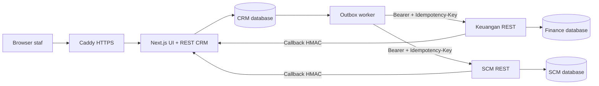
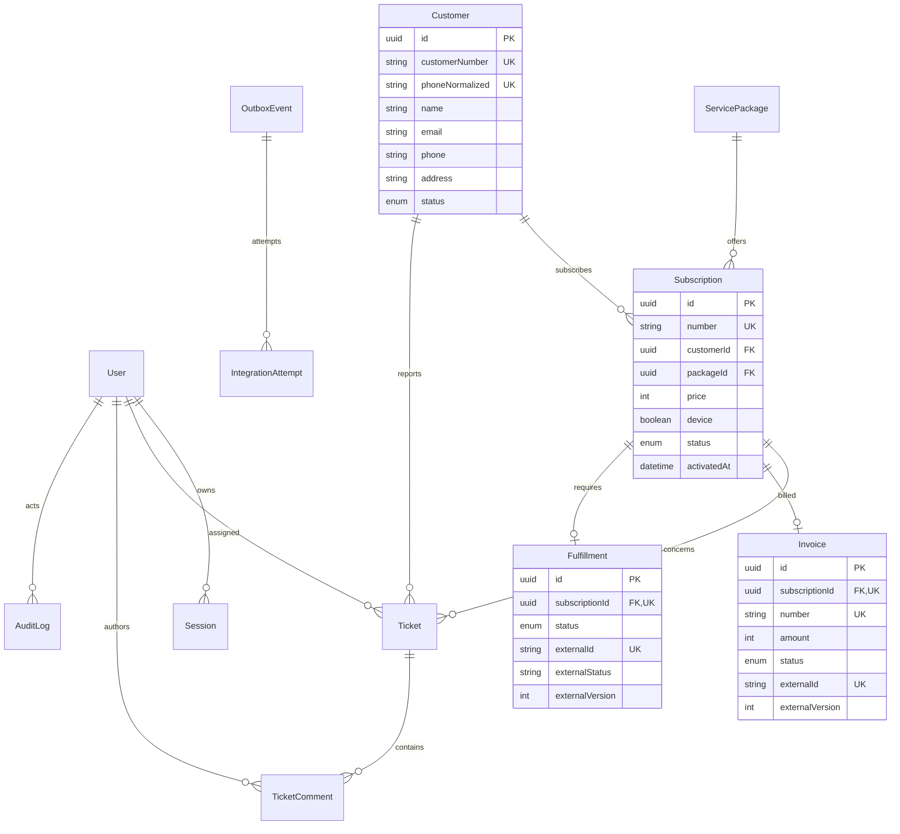
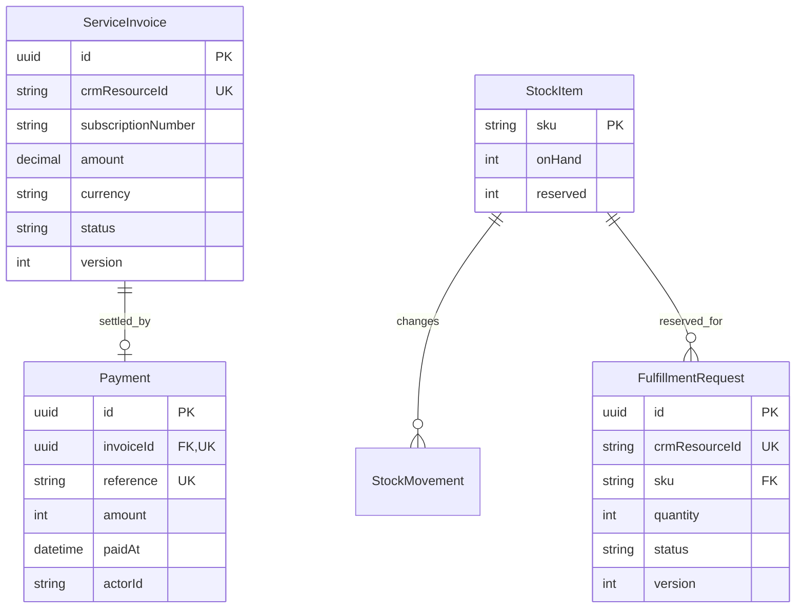

# Arsitektur dan kepemilikan data

Browser mengakses Next.js pada origin yang sama. Route API memvalidasi sesi, CSRF, peran dan input sebelum transaksi PostgreSQL. Frontend tidak menyimpan database di localStorage. Semua perubahan memakai identitas akun server. UI menyegarkan state setiap 4 detik dan saat jendela kembali aktif.



## ERD CRM



Lihat schema Prisma untuk tipe/field lengkap. `Workspace` menyediakan revision dan lock transaksi; `CommandReceipt` menjaga idempotensi mutasi per aktor; `InboxEvent` memiliki unique(source, externalEventId); `OutboxEvent` memiliki dedupeKey unik, lease, retry budget dan jadwal; `LoginAttempt` membatasi percobaan login. Activity untuk laporan operasional dan AuditLog untuk jejak aktor server. Tidak ada hard delete pelanggan/langganan yang menghilangkan riwayat relasi.

## ERD layanan terpisah



Masing-masing database memakai schema layanan yang sama, tetapi proses Keuangan hanya mengakses API invoice/payment dan proses SCM hanya inventori/fulfillment. Tabel yang tidak digunakan tetap kosong. Keduanya mempunyai `Callback` persisten dan `IdempotencyRequest`. Referensi resource CRM berupa ID eksternal; tidak ada FK atau query lintas database. Role aplikasi dipisah per database. Compose hanya memasukkan credential masing-masing database/token ke service pemiliknya; password superuser hanya ada pada container database. Pemisahan ke mesin PostgreSQL berbeda bisa dilakukan dengan mengganti URL, tanpa perubahan kontrak REST.

## Konsistensi dan kegagalan

- Pembuatan langganan menulis snapshot harga kontrak, invoice, fulfillment bila perlu, serta outbox dalam satu transaksi CRM.
- Worker mengklaim dengan `FOR UPDATE SKIP LOCKED`, lease 30 detik dan token kepemilikan; HTTP timeout 8 detik. Retry eksponensial dibatasi 5 percobaan per jadwal CRM. Admin dapat memberi 5 kesempatan tambahan. Lease habis tanpa budget menjadi FAILED.
- Service menulis resource, receipt idempotensi dan callback dalam satu transaksi. Lock stok mencegah reservasi ganda. Callback otomatis sampai 20 percobaan; retry administratif mereset budget callback gagal.
- HMAC SHA-256 meliputi timestamp dan raw body. CRM menolak signature salah atau timestamp di luar jendela 5 menit. Inbox mengabaikan event duplikat; version mengabaikan status usang dan melindungi status terminal.
- Status ACTIVE memerlukan invoice PAID serta fulfillment FULFILLED bila perangkat diperlukan. Harga paket baru tidak mengubah kontrak lama. Cancellation menghasilkan kompensasi invoice belum lunas dan reservasi belum diserahkan.
- Tidak ada transaksi terdistribusi dua fase. Delivery bersifat at-least-once; idempotensi menangani retry. Refund/retur barang setelah pembayaran/penyerahan membutuhkan rekonsiliasi, bukan saldo fiktif.

## Hak akses

| Peran | Kewenangan server |
|---|---|
| ADMIN | Seluruh operasi, akun staf, pembayaran manual, stok, serah-terima dan retry |
| CS | Pelanggan, langganan, tiket dan penugasan; tidak mengubah ledger Keuangan/SCM |
| TECHNICIAN | Membaca tiket yang ditugaskan beserta pelanggan/langganan terkait; menambah catatan dan menangani tiket tersebut |
| MANAGER | Membaca dashboard/laporan/data operasional; seluruh mutasi ditolak |

Password scrypt dengan salt acak. Cookie opaque HttpOnly, SameSite=Lax dan Secure pada HTTPS; hanya hash token sesi disimpan, expiry 8 jam. Logout mencabut sesi, pergantian password mencabut sesi lain, role/isActive dicek ulang. Tidak ada pemilihan peran bebas di UI. Origin dan token CSRF dibutuhkan untuk mutasi browser. Secret service hanya berada di server.

## Struktur dan pembagian tim

```text
src/app/                 App Router, login, dashboard pages, API v1
src/components/          shell responsif, dialog, tabel dan kontrol
src/modules/             pelanggan, paket, langganan, tiket, laporan, integrasi
src/server/              auth, transaksi/state, gateway/callback, worker
prisma/                  schema dan migrasi CRM
services/                server Finance/SCM, protocol, schema/migrasi terpisah
scripts/                 provisioning, migrasi, bootstrap, pengujian
ops/                     Caddy, database init, override lokal, backup, Pages status
tests/                   unit, API/integration, Playwright
docs/                    laporan, kontrak, ERD dan deployment
```

| Anggota | Area review/lanjutan yang disarankan |
|---|---|
| 1 | Auth, sesi, RBAC, bootstrap akun dan keamanan API |
| 2 | Pelanggan, paket, langganan dan schema/migrasi CRM |
| 3 | Tiket, penugasan, dashboard, laporan dan aksesibilitas |
| 4 | Keuangan, pembayaran/ledger, outbox/inbox dan kontrak callback |
| 5 | SCM, inventori, Docker/VPS, CI dan pengujian end-to-end |

Gunakan PR kecil pada feature branch, review silang, CI wajib lulus dan satu penanggung jawab migrasi. Global workspace lock serta pengambilan snapshot seluruh workspace cocok untuk lingkup proyek/volume kecil; untuk skala operator besar perlu query halaman langsung di database, pengarsipan audit, pemisahan worker dan load testing. Tidak ada klaim benchmark skala nasional.
