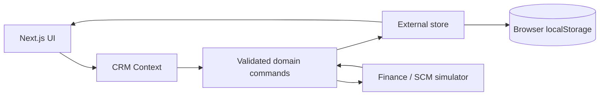

# Implementasi demo CRM lengkap dan pembaruan tampilan

Tanggal: 14 November 2026 (Asia/Jakarta). Kelanjutan setelah pengguna meminta seluruh alur website dapat dicoba tanpa pengerjaan bertahap, dengan tampilan menyerupai portal operator telekomunikasi.

## Hasil

Semua halaman penanda diganti dengan antarmuka operasional. Tema Nusa memakai navy dan merah dengan ilustrasi konektivitas, katalog fiber, dashboard dari data aktual demo, tabel, dialog, empty state, notifikasi, dan tampilan mobile. Identitas tetap Nusa; tidak memakai logo atau mengaku sebagai Telkom/Telkomsel.

Fitur mencakup pelanggan, paket, langganan, tiket, simulator Keuangan/SCM, laporan, simulasi peran, backup/restore/reset. README memuat matriks fitur dan langkah demonstrasi. Implementasi baru berada di `feat/complete-crm-demo` sebelum masuk melalui PR.

## Arsitektur demo

Context/store memakai useSyncExternalStore sehingga snapshot server stabil dan data browser baru dipulihkan setelah hydration. Perubahan disimpan sebelum snapshot/UI diperbarui; kegagalan penyimpanan menampilkan error tanpa mengklaim perubahan sudah tersimpan. Zod memvalidasi input, snapshot dan backup. Restore memeriksa ID unik serta relasi pelanggan, paket, langganan, tiket, invoice, fulfillment dan event.

Tidak ada backend autentikasi/API yang dibuat. Prisma/PostgreSQL tetap fondasi Customer dari tahap awal. Data demo bukan sumber data PostgreSQL, tidak sinkron antarperangkat, dan peran dapat dipilih sendiri untuk simulasi. Integrasi tidak menghubungi layanan luar atau melakukan pembayaran nyata. Penggunaan produksi membutuhkan implementasi server dan layanan yang belum tersedia.

## Aturan bisnis

- Nomor telepon pelanggan unik; pelanggan dengan langganan berjalan tidak boleh dinonaktifkan.
- Paket nonaktif tidak tersedia untuk pendaftaran baru. Harga dan kebutuhan perangkat disalin ke kontrak langganan.
- Pembuatan langganan menghasilkan invoice serta event Keuangan; paket yang memerlukan perangkat juga menghasilkan fulfillment dan event SCM dalam perubahan lokal yang sama.
- Invoice harus diterbitkan melalui event sebelum callback pembayaran. Perangkat harus diminta sebelum callback pemenuhan.
- Aktivasi hanya terjadi ketika invoice lunas dan perangkat terpenuhi bila diperlukan.
- Simulator offline menghasilkan event gagal dengan jumlah percobaan. Retry memakai ID event yang sama dan tidak menciptakan invoice ganda.
- Callback dengan ID yang sama tidak diproses berulang. Langganan yang dibatalkan tidak dapat dilanjutkan atau mengirim event baru.
- Teknisi simulasi hanya menangani tiket yang ditugaskan kepadanya. Tiket membutuhkan assignee sebelum ditangani, serta catatan sebelum diselesaikan. Penutupan dilakukan Admin/CS.
- Manajer simulasi hanya membaca data dan laporan. Semua batas ini adalah aturan demo lokal, bukan otorisasi server.
- CSV menghindari eksekusi formula dari input pengguna. Reset dan restore meminta konfirmasi.

## Verifikasi aktual

| Pemeriksaan | Hasil lokal |
|---|---|
| Lint tanpa warning | Lulus |
| TypeScript strict dan route type generation | Lulus |
| Unit test domain | 7 lulus |
| Browser production Chromium | 7 alur lulus |
| Browser hasil ekspor Pages dengan prefix /crm-telko/ | 7 alur lulus |
| Layout mobile | 8 menu diperiksa pada lebar 390px, tanpa halaman meluap |
| Penyimpanan reload | Lulus |
| Backup/restore dan penolakan JSON tidak valid | Lulus |
| Koneksi PostgreSQL / API eksternal | Tidak diuji; tidak dipakai demo |

Alur E2E: buat/edit pelanggan dan reload; langganan hingga aktif dengan retry; tiket sampai ditutup; perubahan harga mempertahankan kontrak lama; peran manager dan CSV; navigasi mobile dan Escape; backup/reset/restore. E2E memakai production server, bukan hanya markup SSR. Hasil CI dan deployment terbaru tersedia di tab Actions; pemeriksaan publik dijalankan lagi setelah publikasi.

## Kendala yang diperbaiki

1. Pengujian awal pada dev server tidak melakukan hydration karena handshake HMR diblokir untuk origin pengujian 127.0.0.1. Pengujian dipindahkan ke production server agar sama dengan perilaku publik.
2. Select di dalam label pembungkus sulit ditargetkan secara tepat. Komponen Field sekarang memakai label htmlFor dan ID kontrol eksplisit dari useId.
3. Elemen sr-only pada header tabel keluar dari scroll container dan membuat lebar halaman 485px pada viewport 390px. Scroll container diberi positioning relative; seluruh menu kemudian lulus pemeriksaan lebar.
4. Pemeriksaan toast awal juga menangkap route announcer Next.js. Locator pengujian dibatasi pada pesan yang dimaksud.
5. Kartu integrasi mobile disusun ulang agar teks dan tombol tidak saling menyempit.

## Perintah

- `git switch -c feat/complete-crm-demo`
- `npm install zod`, `npm install -D @playwright/test tsx` dengan cache workspace; lockfile disimpan.
- `npm run lint`, `npm run typecheck`, `npm test`
- `npm run test:e2e` membangun dan menjalankan server production pada port 3100.
- Chromium yang tersedia di environment dipakai tanpa memasang browser lain. Di CI digunakan browser Playwright resmi.
- Prettier dijalankan untuk keterbacaan source; file tiap modul dipisahkan dari renderer route.
- `GITHUB_PAGES=true npm run build`: lulus, 11 halaman dihasilkan. Ekspor dilayani pada HTTP server lokal dengan prefix /crm-telko/; seluruh 7 E2E lulus kembali.
- Screenshot desktop, katalog paket dan mobile disimpan pada docs/images.
- Next dev menghasilkan AGENTS.md otomatis. Panduan static exports, Playwright, dan usePathname dari node_modules/next/dist/docs telah diperiksa.
- Hasil ekspor Pages dibangun dan diverifikasi sebelum publikasi. Pengujian E2E dapat diarahkan ke situs publik melalui E2E_BASE_URL tanpa mengubah data pengguna lain.

## Batas penggunaan

Gunakan identitas fiktif. Menghapus data browser menghapus perubahan lokal. Tidak tersedia multiuser bersamaan dengan transaksi database, SLA otomatis, billing berulang, refund, atau provisioning jaringan. Demo ini memberi gambaran lengkap alur dan UI, bukan implementasi CRM produksi yang aman.
